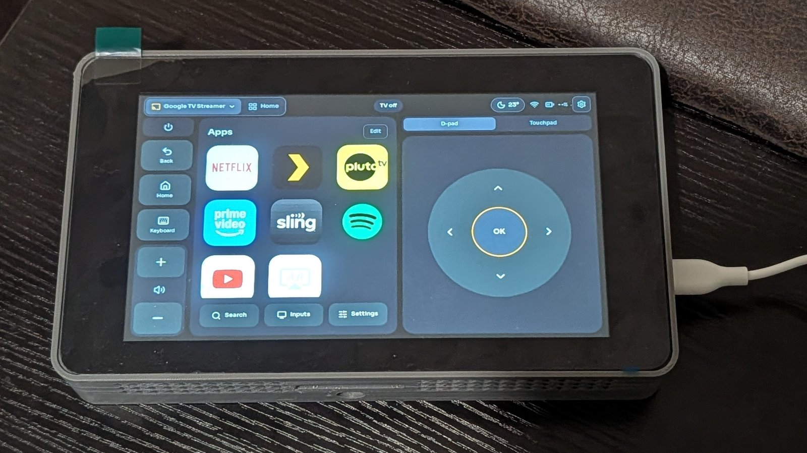
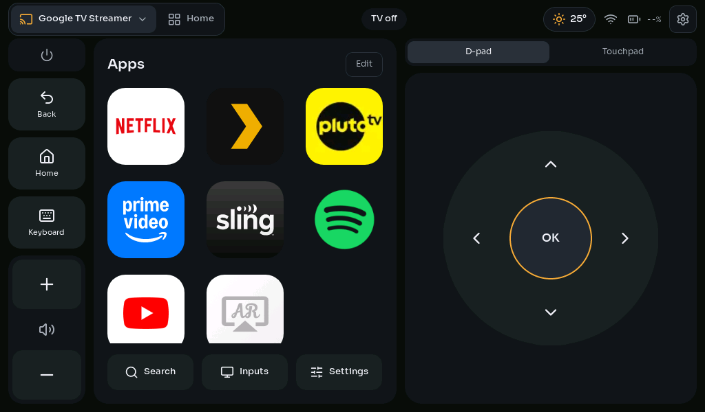

# Hubmote

A touchscreen remote for the **[Google TV Streamer](https://store.google.com/product/google_tv_streamer)**, built on Waveshare's
ESP32-S3 touch boards. It talks to the Streamer over Wi-Fi with the same
protocol as Google's phone app, follows whatever app is on the TV, and
controls the TV and other devices over IR.

<p align="center">
  
  
</p>

- **Follows the TV:** the app grid on Google TV's Home, then each app's
  playback controls, and a keyboard when the TV asks for one.
- **Types into most apps** with the optional companion app (browsers, apps'
  own on-screen keyboards, Google TV's search), and shows the title of
  what's playing where the app shares it.
- **The TV over IR:** built-in codes for 18 brands, or learned from its
  remote; other IR devices (an HDMI switch, a soundbar) by learning.
- **Modules** on a Home tab (Weather first), five themes, battery power
  with deep sleep.
- **No build tools needed:** install from a web page in Chrome or Edge;
  later updates come from the remote itself.

## What you need

- A Waveshare ESP32-S3 touch board: the **ESP32-S3-Touch-LCD-7B** (7",
  the one Hubmote is made on), or the 7, 5B, 5, 4.3, 4.3B or 4.3C
  (supported, not yet tried: [what each can do](docs/porting.md#the-boards)).
- A [Google TV Streamer](https://store.google.com/product/google_tv_streamer), and a 2.4 GHz Wi-Fi network.
- Optional: an IR receiver and transmitter, a LiPo battery, and the
  [3D-printed case](hardware/enclosure).

## Get started

1. **Install** the firmware from **https://dovahbrownies.github.io/Hubmote/**
   with Chrome or Edge and a USB-C cable.
2. **Set it up on the remote:** pick your Wi-Fi, pick your Google TV, and
   type the code the TV shows.
3. **Optional:** install the [companion app](docs/companion.md) on the
   Streamer, and [wire up IR](docs/hardware.md).

[Getting started](docs/getting-started.md) has every step.

> [!NOTE]
> **Or ask your AI agent to set it up for you.** Paste this into Claude
> Code, Codex, Cursor or another coding agent on the computer the board is
> plugged into:
>
> ```text
> Set up Hubmote for me: https://github.com/DovahBrownies/Hubmote
>
> Clone the repository and read its CLAUDE.md and the guides in docs/
> first. Then:
> 1. Ask me which board I have and tell me what it can and can't do
>    (docs/porting.md). Find the USB port it's on (docs/hardware.md says
>    how it shows up) or ask me, and don't flash anything until I've
>    confirmed the port.
> 2. Install what this computer needs (docs/building.md), build the
>    firmware for my board and flash it over USB. If I'd rather not
>    install build tools, guide me through the web installer instead.
> 3. Walk me through the first start on the remote (Wi-Fi, picking my
>    Google TV, pairing), the HDMI-CEC settings for volume, and Rotate
>    180° if the board is in the 3D-printed case. I'll type my Wi-Fi
>    password on the remote myself.
> 4. Offer to install the companion app on my Google TV Streamer
>    (docs/companion.md): from this computer over Wireless debugging, or
>    on the TV with the Downloader app. Explain the difference, ask me
>    which I prefer, then pair it with the remote.
> 5. If I have IR parts, a battery, a power switch or the case, help me
>    with them (docs/hardware.md), and add my TV on the remote.
> 6. At the end, check with me that it all works: a key, volume, opening
>    an app, typing into a search field, and an IR key if wired. Fix what
>    doesn't (docs/troubleshooting.md), and show me how updates work.
>
> Before each step, tell me what it does and roughly how long it takes.
> Ask before changing anything on my TV or Streamer. Never print my Wi-Fi
> password or the remote's update token: when a step needs the token,
> I'll put it in secrets.env myself.
> ```

## Guides

| Guide | What's in it |
|---|---|
| [Getting started](docs/getting-started.md) | Installing, the first start, pairing, volume, updates |
| [Using the remote](docs/using.md) | The screens and the settings |
| [Companion app](docs/companion.md) | Installing and pairing it |
| [Hardware](docs/hardware.md) | IR wiring, the battery, a power switch, the case |
| [Troubleshooting](docs/troubleshooting.md) | Logs and common problems |
| [Building from source](docs/building.md) | Building, flashing and updating your own firmware |
| [Boards](docs/porting.md) | The supported boards, and adding one |
| [Modules](docs/modules.md), [themes](docs/themes.md), [TVs over IR](docs/ir-tvs.md) | Extending it |
| [Security](docs/security.md), [releasing](docs/releasing.md), [plan](docs/PLAN.md) | What it protects, how releases go out, what's next |
| [Firmware](firmware/remote/README.md), [companion](companion/README.md) | The code |

## Status

Tested on the 7B with a Google TV Streamer. Not checked yet: the other
boards ([#44](https://github.com/DovahBrownies/Hubmote/issues/44)), the built-in TV code sets at real TVs
([#12](https://github.com/DovahBrownies/Hubmote/issues/12)), and battery life ([#18](https://github.com/DovahBrownies/Hubmote/issues/18)). Netflix,
Prime Video and Plex don't share what's playing, and Prime Video can't be
typed into (search from Google TV's Home instead). Open work is in the
[issues](https://github.com/DovahBrownies/Hubmote/issues).

## License

The code is licensed under the [Apache License 2.0](LICENSE); the
enclosure's 3D models, a remix of 3D_Project3R's case, under
[CC BY-SA 4.0](hardware/enclosure/LICENSE). [NOTICE](NOTICE) lists the work
Hubmote builds on and its licenses.

[Contributing](CONTRIBUTING.md) · [Code of conduct](CODE_OF_CONDUCT.md) ·
[Reporting a security problem](SECURITY.md)
