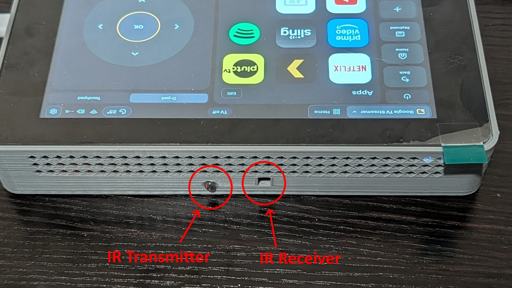

# Hardware

Wiring IR, adding a battery and a power switch, and the case. This describes
the ESP32-S3-Touch-LCD-7B. The 7 is wired the same way for USB and IR,
but can't read its battery and only switches its backlight on and off.
What the other boards can do is in [the boards table](porting.md#the-boards).

## Parts

What the remote in the photo is built from:

| Part | Used here |
|---|---|
| The board | Waveshare ESP32-S3-Touch-LCD-7B ([Waveshare](https://docs.waveshare.com/ESP32-S3-Touch-LCD-7B)) |
| IR receiver and transmitter | DKARDU 38 kHz kit ([Amazon](https://www.amazon.com/dp/B0C9TGJ99R)) |
| Battery | [Amazon](https://www.amazon.com/dp/B0GL1MH5YT); what to look for is under [Battery](#battery) |
| Power switch | [Amazon](https://www.amazon.com/dp/B0BZHZDBBY) |
| USB-C extension, bringing the board's USB port to the side of the case | [Amazon](https://www.amazon.com/dp/B0H6WVZ9L5); where its plug doesn't fit, a short flat one with a 90° plug ([Amazon](https://www.amazon.com/dp/B0G28KVFP3)) |
| Screws for the case | Four M3 × 14 mm, for example from this set ([Amazon](https://www.amazon.com/dp/B0FS1R3HVB)) |
| The case | [hardware/enclosure](../hardware/enclosure) (3D-printed) |

## USB connectors

The 7B has two USB-C connectors (so do the 7 and the 4.3; the 4.3B, 4.3C,
5 and 5B have only the native one):

| Connector | Shows up as | Use |
|---|---|---|
| **USB** (native) | "USB Serial Device" or "USB JTAG/serial debug unit", VID 303A | Installing **and** logs. Use this one. |
| UART (CH343) | "USB-Enhanced-SERIAL CH343" | Installing only, with SW1 on UART1; no logs |

## IR

Parts: a 38 kHz IR receiver module ("1838") and an IR LED module, such as
the [DKARDU kit](https://www.amazon.com/dp/B0C9TGJ99R), plus HY2.0 leads
(the 7B's box has one 3-pin and two 4-pin). Unplug the board before
wiring.

**Receiver → J8**, the 3-pin "GPIO" socket:

| J8 pin | Signal | Receiver pin |
|---|---|---|
| 1 | 3V3 | VCC ("+", usually the middle pin) |
| 2 | GND | GND ("−") |
| 3 | GPIO6 | OUT / S / DAT |

Never power it from 5 V: its output goes straight into GPIO6.

**Transmitter → H3**, the 4-pin UART socket:

| H3 pin | Signal | Transmitter pin |
|---|---|---|
| 1 | 3V3 | VCC ("+") |
| 2 | GND | GND ("−") |
| 3 | RXD = GPIO44 | S / signal |
| 4 | TXD = GPIO43 | not used |

**Set SW1 to UART2.** SW1 is the small slide switch just left of the BOOT
button, marked `UART2 UART1`. It connects the chip's UART pins either to
the USB-to-serial chip (UART1) or to H3 (UART2); on UART1 the transmitter
gets nothing. Don't confuse it with SW2 (`120R`, CAN/RS-485), which only
adds bus termination: leave that off.

In the case, both look out of the same edge, side by side:

**Check it:** add a TV (switcher > Add a TV), tap a key and watch the LED
through a phone camera (the front one: many rear cameras filter infrared):
it should flicker. If not, check SW1. Moving the wire to pin 4 also needs
your own build with `HM_IR_TX_GPIO` set to 43 ([building](building.md#options)):
the installer's firmware sends on pin 3.

**Range.** At 3.3 V the kit's LED reaches about a metre. For a room, drive
an IR LED from 5 V through a MOSFET: GPIO44 → 100 Ω → the gate of a
logic-level N-MOSFET (AO3400, 2N7002), 100 kΩ from gate to GND; 5 V (the
board's J9 header) →
about 15 Ω → a 940 nm LED → drain; source to GND; 220–470 µF across 5 V
and GND near the LED. That gives 100–200 mA pulses and 5–8 m; two LEDs in
series with about 10 Ω widen the beam.

**Other boards:** the 4.3 takes the transmitter on its "Sensor AD" socket
J6 (3V3, GND, GPIO6) and has no pin left for a receiver; the 4.3B, 4.3C,
5 and 5B have no free pin for IR.

## Battery

The figures here come from the 7B's schematic and its charger's datasheet;
the runtimes are estimates until measured.

**A protected single-cell 3.7 V LiPo with a PH2.0 plug.** Check "+" and "−"
against the board's markings before plugging it in: sellers wire PH2.0
both ways round, and reversed polarity can destroy the charger. To fix a
reversed plug, lift each pin's latch with a needle and swap the wires.

- **Size:** about 3000 mAh gives roughly 5–7 h with the screen on and
  charges in about 6 h (the board charges at a fixed 580 mA). A 5000 mAh
  "115659" cell (about 11 × 56 × 59 mm, 90 g) gives 8–11 h and takes about
  10 h to charge. Waveshare suggests at most 2000 mAh without saying why.
  These are estimates until measured (`firmware/power-test`).
- **Protection:** the board has no short-circuit protection and its boost
  cuts out at about 2.7 V, so the cell needs its own protection board.
- **Mounting:** behind the board on foam tape, nothing hard against the
  pouch. A third (thermistor) wire stays unconnected.
- **Faster charging:** replace R64 (the charger's PROG resistor): 1.2 kΩ is
  the stock 580 mA, 0.75 kΩ about 900 mA, 0.68 kΩ about 1 A. More current
  means more heat; the charger then throttles itself.
- **First charge:** outside any case, screen off, and feel the board now
  and then. The DONE LED lights when it's full.

**Charging indicator** (boards that read their battery: the 7B and the
4.3C). The board doesn't tell the ESP32 about USB power, so the remote
works it out from the battery readings: on battery the boost
converter makes them swing, on USB they hold steady. About 10 seconds after
plugging in (with the screen on), the top bar shows the green battery with
a bolt.

**A faint buzz on battery** is coil whine from the boost converter
(the CS8501 and its inductor L2), harmless and absent on USB. A dab of
5-minute two-part epoxy on L2 (the 4.4 × 4.2 mm inductor next to U4)
usually quietens it: board unplugged, cleaned with isopropyl alcohol, epoxy
on L2 only, cured fully before powering up. Press L2 gently with a toothpick
while it buzzes first: if the sound doesn't change, it's a capacitor near U4
instead.

## Power switch

The board has none: it runs whenever a battery is connected, and *Turn off
remote* is deep sleep, which still draws a little. For a real off, put a
latching switch rated 1 A or more in the battery's **red (+)** wire,
between the cell and the plug (flat push buttons such as a KAN-28 or P-107
fit a case). Solder it, cover the joints with heat-shrink, and check the
polarity at the plug before connecting it.

Switched off, the battery doesn't charge: USB still runs the remote, but
the top bar shows `--%`. To charge while not using it, leave the switch on
and use *Turn off remote*.

## The case

[hardware/enclosure](../hardware/enclosure) has a 3D-printable case for the
7B, closed with four M3 × 14 mm screws. A short USB-C extension brings the
board's USB port to the side of the case, for charging and updates over
USB. If there's no room in the case for its plug, use a short, flat
extension with a 90° plug instead (both in the [parts](#parts)); either
must carry data, not only power. The board sits in it upside down: turn on
**Settings > Screen > Rotate 180°**.
